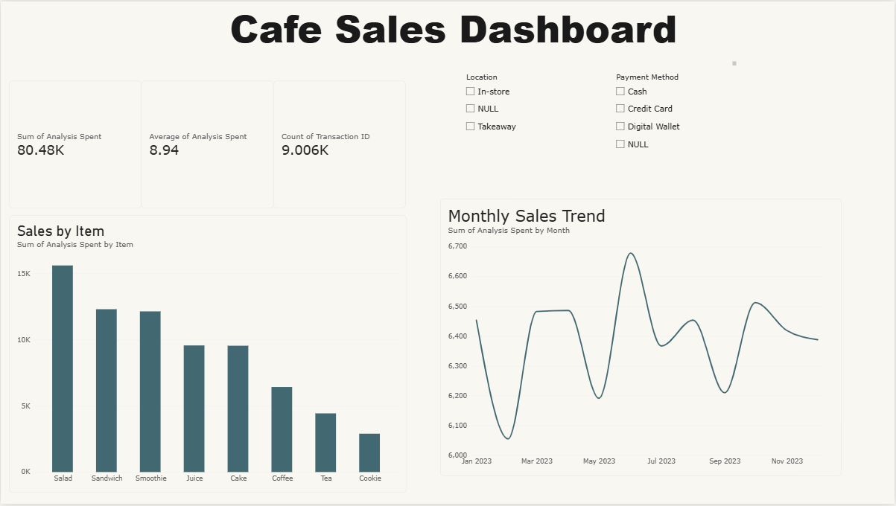

# SWYNEX Final Data Analytics Project

## Project goal
Explore café sales to see which products sold the most, how sales changed by month, and how customers paid.

## Dataset
This dataset contains 9,006 café transactions from 2023. Each row represents one transaction. The columns include Transaction ID, Item, Quantity, Price Per Unit, Total Spent, Payment Method, Location, and Transaction Date. Some fields contain “NULL,” which means the information was missing.

## Cleaning Process
Using MySQL Workbench, I kept the original table and created a cleaned table. I checked for blank, ERROR, and UNKNOWN values, and checked for duplicate Transaction IDs. I changed blank, ERROR, and UNKNOWN values to NULL. I also changed Total Spent to a decimal number and Transaction Date to a date. I checked that available Total Spent values matched Quantity × Price Per Unit.

## Analysis
I used Excel to calculate total, average, and median spending. I used PivotTables and charts to compare sales by product and month, and to count transactions by location and payment method. I left missing “NULL” values out of comparisons where the category or date was needed.

## Dashboard
I created a dashboard in Power BI. It shows total recorded sales, average spending per transaction, and transaction count. It includes a chart comparing sales by product, a chart showing monthly sales, and filters for location and payment method. The Power BI file is SWYNEX_Cafe_Sales_Creative_Dashboard.pbix.

## What I did
- Cleaned and prepared the sales data using mySQL.
- Checked missing values and calculated basic statistics in Excel.
- Built charts to compare products and monthly sales.
- Created an interactive Power BI dashboard with location and payment method filters.

## Key findings
- Product sales: Salad had the highest recorded sales at 15,600, while Cookie had the lowest at 2,898. The cafe could review what makes Salad popular and whether                   Cookie needs a closer look.
- Monthly sales: Among transactions with a known date, June had the highest sales at 6,678, and February had the lowest at 6,055.
- Order location: In-store and takeaway counts were very close: 2,731 and 2,711. Neither order type was far ahead.
- Payment methods: Among transactions with a recorded payment method, Cash, Credit Card, and Digital Wallet were used at similar rates.
- Spending: The average transaction was 8.94, compared with a median of 8.00. This suggests some higher-spending transactions raised the average.

## Tools
- mySQL
- Microsoft Excel
- Power BI

## What I learned
I practised preparing data, finding patterns, and explaining results with charts and filters.

## Project files
- `cafe_sales_cleaning.sql` — MySQL cleaning queries
- `cafe_sales_cleaned.csv` — cleaned the data using mySQL
- `SWYNEX_Cafe_Sales_EDA.xlsx` — Excel analysis
- `SWYNEX_Cafe_Sales_Creative_Dashboard.pbix` — Power BI dashboard
